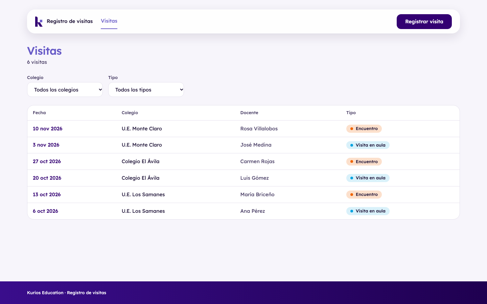

# Registro de visitas a colegios

[](https://github.com/betomartinez13/kurios-prueba-tecnica/actions/workflows/ci.yml)

Aplicación para que los especialistas de Kurios Education registren y consulten las visitas
que hacen a los colegios: colegio, docente visitado, fecha, tipo (visita en aula o encuentro)
y observaciones. Backend en Django REST Framework con PostgreSQL y frontend en Next.js.



> **Dónde está cada entregable:**
> [Cómo ejecutarlo](#cómo-ejecutarlo) ·
> [Funcionalidades requeridas](#funcionalidades-requeridas) ·
> [Decisiones técnicas](#decisiones-técnicas) ·
> [Qué quedó fuera](#qué-quedó-fuera) ·
> [Siguiente iteración](#siguiente-iteración) ·
> [Uso de inteligencia artificial](#uso-de-inteligencia-artificial)

## Cómo ejecutarlo

Requisitos: Docker con Compose v2 y `make`.

```bash
make up
```

`make up` crea `.env` a partir de `.env.example` si no existe, construye las imágenes y espera
a que los tres servicios (`db`, `backend`, `frontend`) estén sanos. Al arrancar, el backend
aplica las migraciones y carga los datos de demostración: 3 colegios, sus docentes, 6 visitas
y el superusuario.

| Qué | URL |
|---|---|
| Aplicación | http://localhost:3000 |
| API (Swagger) | http://localhost:8000/api/docs/ |
| Admin de Django | http://localhost:8000/admin/ (usuario `admin`, contraseña `admin`) |

| Comando | Qué hace |
|---|---|
| `make down` | Detiene los contenedores (los datos se conservan) |
| `make reset` | Detiene todo y borra la base de datos; el siguiente `make up` vuelve a los datos de demostración |
| `make test` | Tests del backend (pytest) dentro de Docker |
| `make e2e` | Tests end-to-end con Playwright en un stack aislado, que no toca los datos de la demo |
| `make e2e-ver` | Lo mismo, con el navegador visible, a cámara lenta y un test cada vez |

`make e2e` levanta una copia aparte del stack (proyecto compose `e2e`, puertos 3100 y 8100,
volumen propio), ejecuta Playwright y la destruye al terminar. Playwright corre en tu máquina,
por lo que la primera vez necesita Node 24 y:

```bash
cd frontend && npm ci && npx playwright install chromium
```

`make help` lista el resto. Para ejecutar sin Docker o ajustar la velocidad y los tests de los
E2E, consulta [`docs/desarrollo.md`](docs/desarrollo.md).

## Funcionalidades requeridas

`make test` ejecuta todas las pruebas del backend y `make e2e` todas las de navegador real. Para correr solo una: las E2E con `make e2e E2E_FLAGS='-g "texto"'` y las de backend con `docker compose run --rm backend uv run pytest -q -k nombre`. Cada fila indica el archivo y el nombre de la prueba que respalda el requisito.

| # | Requisito | Cómo se cumple | Cómo comprobarlo |
|---|---|---|---|
| 1 | Registrar una visita: colegio, docente, fecha, tipo (visita en aula o encuentro) y observaciones | Formulario de registro. El docente se elige entre los del colegio seleccionado | **Manual:** en http://localhost:3000, pulsa «Registrar visita».<br>**Prueba E2E:** `form.spec.ts` › `create a valid visit` |
| 2 | Listar las visitas, con filtro por colegio y por tipo | Listado con ambos filtros. Quedan en la URL, así que se pueden compartir como enlace | **Manual:** en http://localhost:3000, cambia los filtros y recarga la página: se conservan.<br>**Prueba E2E:** `list.spec.ts` › `filters apply on change`<br>**Prueba backend:** `test_list_filters_and_hides_deleted` |
| 3 | Consultar el detalle de una visita y editarla | Pantalla de detalle y de edición, con el formulario precargado. «Editar» conserva los filtros del listado | **Manual:** abre una visita desde el listado y edítala.<br>**Pruebas E2E:** `form.spec.ts` › `edit saves changes` y `detail.spec.ts` › `edit keeps list filters` |
| 4 | Eliminar sin borrar físicamente (eliminación lógica) | Campo `deleted_at`: la visita deja de mostrarse y el registro se conserva. Se puede [restaurar desde el admin](#restaurar-una-visita-eliminada) | **Manual:** elimina una visita y comprueba en http://localhost:8000/admin/ que el registro sigue ahí.<br>**Prueba E2E:** `detail.spec.ts` › `delete with confirmation`<br>**Prueba backend:** `test_delete_returns_204_and_keeps_row` |
| 5 | Validar que la fecha no sea futura y que los campos obligatorios estén completos | Reglas en el backend (`visits/services.py`): fecha no futura ni anterior a 2000, y observaciones obligatorias de hasta 5000 caracteres. El frontend las refleja con Zod y pinta cada error en su campo | **Manual:** guarda una visita con fecha futura o sin observaciones y verás el error en su campo.<br>**Prueba backend:** `test_create_rejects_future_date`<br>**Prueba E2E:** `form.spec.ts` › `empty submit shows field errors` |

### Restaurar una visita eliminada

Eliminar una visita es un borrado lógico: deja de verse en la aplicación pero el registro
sigue en la base de datos. Para recuperarla:

1. Entra en http://localhost:8000/admin/ con `admin` / `admin`.
2. Abre **Visitas › Visits**. El admin muestra todas las visitas, con la columna
   «Eliminada».
3. Filtra por **Estado › Eliminadas**, marca las visitas que quieras recuperar, elige la
   acción **«Restaurar visitas seleccionadas»** y pulsa **Ir**.

## Decisiones técnicas

El diseño completo está en [`docs/superpowers/specs/`](docs/superpowers/specs/): el
[documento principal](docs/superpowers/specs/2026-11-19-registro-visitas-design.md), el del
[backend](docs/superpowers/specs/2026-11-19-backend-design.md) y el del
[frontend](docs/superpowers/specs/2026-11-19-frontend-design.md). Las decisiones que más
condicionan el resultado:

| Decisión | Por qué |
|---|---|
| **Next.js como framework de React.** | Encaja con el perfil (React, TypeScript y SASS) y es un estándar en la industria. Son dos apps independientes que solo se hablan por HTTP y JSON. |
| **Componentes de cliente y proxy de Next a Django.** El navegador pide `/api/...` a Next, que lo reenvía al backend con `rewrites`, también en producción. | Una sola forma de pedir datos, sin CORS (para el navegador todo es del mismo origen) y con los errores de validación de Django pintados en su campo. La lógica vive en Django, donde se prueba. Se pierde el render en servidor, que aquí no aporta. |
| **docker-compose para levantar todo.** `db` (Postgres 17), `backend` y `frontend`, con healthchecks y orden de arranque. Un solo repo, dos apps y un `Makefile` como único punto de entrada. | Que quien evalúe el proyecto lo levante a la primera con solo Docker y `make up`, sin instalar Postgres, Python ni Node, y con las mismas versiones que yo. Al arrancar carga datos de demostración. |
| **Backend por capas: services + selectors.** Las reglas de negocio van en `visits/services.py` y las lecturas en `visits/selectors.py`. | Las reglas quedan en un solo sitio y se prueban sin pasar por HTTP. |
| **Borrado lógico con un solo campo, `deleted_at`.** | El manager por defecto oculta las visitas eliminadas (404 en la API); el admin las ve y puede restaurarlas. Los índices parciales de Postgres cubren solo las activas. |
| **La visita guarda colegio y docente.** | Si un docente cambia de colegio, la visita histórica conserva dónde ocurrió. La coherencia se valida al guardar. |
| **«Hoy» en la zona horaria de Caracas** (`TIME_ZONE`, configurable). | Kurios trabaja con colegios de Venezuela. El `max` del input de fecha es solo una ayuda: la regla la aplica el backend. |
| **Contrato OpenAPI como frontera.** drf-spectacular genera `backend/schema.yml` sin levantar la app y `openapi-typescript` produce los tipos del frontend. Ambos archivos están versionados. | Si el backend cambia un campo, el frontend deja de compilar en lugar de fallar en el navegador, y la CI falla si los archivos no están al día. A cambio hay un paso de generación, `make types`. |
| **E2E con Playwright en lugar de tests unitarios del frontend.** 17 pruebas que recorren los cinco flujos con un navegador real, en un stack aislado. | La lógica importante vive en Django y se prueba con pytest, así que el frontend solo necesita comprobar que los flujos completos funcionan de punta a punta. A cambio, necesita el stack levantado, y por eso aún no corre en la CI. |
| **Frontend:** TanStack Query para el estado del servidor, React Hook Form con Zod en el formulario y filtros en la URL con `nuqs`. | Los errores del servidor se pintan en su campo y los filtros se pueden compartir como enlace. |

**Pruebas y calidad.** 52 tests de backend con pytest (servicios, selectors, API, seed y
configuración) y 17 E2E con Playwright que recorren listado, registro, edición, borrado y
validación. La CI ejecuta ruff, pytest, eslint, prettier, `tsc` y la comprobación del contrato;
`pre-commit` ejecuta ruff, prettier y eslint.

## Qué quedó fuera

De la lista de prioridades no se recortó nada: están las cuatro pantallas con sus estados, la
API con sus tests, los E2E de los cinco flujos, la acción de restaurar en el admin, la CI,
pre-commit y la auditoría de interfaz. Quedó fuera a propósito, porque el enunciado no lo pide:

- Autenticación y usuarios: no hay login en la aplicación.
- Pantallas para gestionar colegios y docentes: vienen precargados (se pueden editar en el
  admin).
- Restaurar visitas desde la interfaz: se hace desde el admin.
- Paginación, búsqueda por texto, exportaciones e internacionalización.
- Los E2E no corren en la CI: necesitan el stack completo y se ejecutan en local con
  `make e2e`.

## Siguiente iteración

- Autenticación y usuarios.
- Paginación del listado.
- E2E en la CI, levantando el stack con docker compose en el job.
- Aviso de posibles visitas duplicadas.
- Bloqueo optimista para que dos ediciones simultáneas no se pisen.
- Confirmación al salir del formulario con cambios sin guardar.
- Deshacer el borrado desde la interfaz.

## Uso de inteligencia artificial

### Herramientas

- **Claude Code** (CLI) con el modelo **Claude Opus 5.5** como orquestador, y subagentes con
  Sonnet 5.5 (tareas estándar y revisiones), Opus 5.5 (base visual del frontend, formulario
  y revisión final) y Haiku 5.5 (re-revisiones pequeñas).
- **Skills de superpowers**: `brainstorming` (diseño), `writing-plans` (plan),
  `subagent-driven-development` (implementación por tareas con una revisión independiente
  después de cada una) y `using-git-worktrees`.
- Un artefacto de claude.ai con una guía y una checklist para revisar la app terminada.

### En qué partes me apoyé

| Parte | Qué hizo la IA | Qué hice yo |
|---|---|---|
| Diseño | Redactó el spec (en tres documentos) y el plan de implementación | Tomé las decisiones de stack, estilo y arquitectura; leí y aprobé los documentos |
| Código | Generó backend, frontend, Docker, `Makefile`, CI y pre-commit, tarea por tarea según el plan | Elegí los patrones y probé a mano en el navegador crear, filtrar, ver, editar y eliminar |
| Tests | Escribió los tests de pytest y los E2E de Playwright | Decidí E2E en vez de tests unitarios de frontend y vi correr los E2E con `make e2e-ver` |

**Decisiones que tomé yo, no la IA:**

- **Next.js con Django.** Elegí Next.js aunque la IA había recomendado React + Vite. Encaja con el
  perfil (React, TypeScript y SASS), es un estándar en la industria y su proxy funciona también en
  producción. Son dos apps independientes que solo se hablan por HTTP y JSON.
- **docker-compose para levantarlo todo.** Quise que quien evalúe el proyecto lo levante a la
  primera con solo Docker y `make up`, sin instalar Postgres, Python ni Node, y con las mismas
  versiones que yo.
- **Que el docente pertenezca a un colegio**, y que cada visita guarde colegio y docente, para
  conservar el historial si un docente cambia de colegio.
- **Comunicación por proxy y componentes de cliente.** Entre las tres opciones que consideré, elegí
  que el navegador pida `/api/...` a Next, que lo reenvía a Django. Hay una sola forma de pedir
  datos, no hace falta CORS y los errores de validación de Django se pintan en su campo. Renuncié
  al render en servidor porque aquí no aporta.
- **services + selectors (HackSoft).** Las reglas de negocio quedan en un solo sitio y se prueban
  sin pasar por HTTP, en lugar de repartirse entre serializers y vistas.
- **Tipos generados desde OpenAPI.** Si el backend cambia un campo, el frontend deja de compilar
  en lugar de fallar en el navegador.
- **uv** para las dependencias de Python.
- **E2E con Playwright en lugar de tests unitarios del frontend.** La lógica importante vive en
  Django y se prueba con pytest, así que el frontend solo necesita comprobar que los flujos
  completos funcionan de punta a punta.
- **Profundicé el spec** en pantallas, flujos y casos borde antes de escribir código, y pedí
  dividirlo en tres documentos: qué se construye, backend y frontend. La IA implementa lo que
  dice el spec, así que me aseguré de dejar bien definido lo importante y la estructura antes de
  empezar.

### Qué tuve que corregir de lo que generó la IA

| Qué generó la IA | Cómo lo detecté | Qué hice |
|---|---|---|
| Una `SECRET_KEY` por defecto en `settings.py` | Revisión independiente de la tarea | Quité el valor por defecto: la app ya no arranca si falta la variable de entorno `SECRET_KEY` |
| Dos E2E del listado que podían pasar sin comprobar nada (selector ambiguo; el test de «un enlace por fila» no lo verificaba) | Revisión independiente | Cambié el selector ambiguo por uno exacto y añadí la comprobación que faltaba: que cada fila tenga un solo enlace al detalle |
| Un E2E del borrado, tal como venía en el plan, que comprobaba un texto que el listado nunca muestra, así que no podía fallar | Revisión independiente | Lo reemplacé por la comprobación de que ya no existe el enlace a la visita eliminada |
| En el formulario: el test de «cambiar de colegio limpia el docente» pasaba aunque esa lógica no existiera; un fallo al cargar docentes se mostraba como «Este colegio no tiene docentes»; una recarga fallida borraba el formulario de edición | Revisión independiente | Corregí los tres con el test en rojo antes del arreglo |
| `/?school=999` mostraba «No se pudo conectar con el servidor» aunque el servidor funcionaba | Revisión final de toda la rama | El filtro se descarta y se limpia de la URL |
| Algunos mensajes de la API salían en inglés o con «usted» | Revisión final de toda la rama | Los corregí |
| Quedaban medidas escritas a mano en los estilos de algunos componentes | Revisión final de toda la rama | Las moví a los tokens de diseño (`_tokens.scss`) |
| El enlace «Editar» perdía los filtros del listado | Revisión final de toda la rama | Ahora «Editar» conserva los filtros del listado, también al cancelar o al guardar |
| La app reintentaba peticiones que la API rechaza por datos inválidos | Revisión final de toda la rama | La app ya no reintenta cuando la API responde que los datos son inválidos o que la visita no existe |
